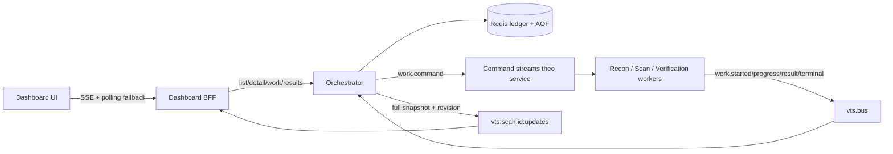

# Báo cáo triển khai VTS — lifecycle authoritative

**Môn:** IT6027 — Chính sách quản trị an ninh mạng  
**Phạm vi bản nâng cấp:** lifecycle, observability và reliability của pipeline VTS.

## 1. Kết quả sửa nguyên nhân gốc

Phiên bản cũ suy luận hoàn tất từ khoảng thời gian không có event mới. Worker chạy song song còn ACK message ngay sau khi tạo background task, còn dashboard tự đóng stage trước khi thấy result của stage sau. Vì vậy giao diện có thể báo cả Scan và Verification hoàn tất khi công việc thật vẫn chạy hoặc đang chờ duyệt.

Phiên bản hiện tại không suy luận thành công từ sự im lặng. Orchestrator là single writer cho trạng thái scan/stage/work và lưu full snapshot trong Redis. Mỗi work được đăng ký trước hoặc atomically cùng command, có work ID deterministic, attempt, lease và execution journal. Worker chỉ ACK command sau khi terminal event cùng journal đã được Redis xác nhận. Dashboard chỉ hiển thị snapshot authoritative có `revision` tăng đơn điệu.

## 2. Kiến trúc lifecycle



Redis có bốn vai trò tách biệt:

1. `vts.bus`: lifecycle, result và approval event v1.
2. `vts.commands.{service}`: command durable theo worker, group bắt đầu từ `0-0`.
3. Ledger Hash/Set/ZSet/String: scan, stage, work, result, approval, dedupe và retry.
4. `vts:scan:{scan_id}:updates`: tối đa 1.000 full snapshots cho SSE resume/reset.

`lag=0` hoặc `pending=0` chỉ là evidence delivery, không phải tiêu chí completion.

### 2.1 Event envelope v1

```json
{
  "schema_version": 1,
  "event_id": "4a277b99-14a0-4f2a-aa4f-d543aaf48684",
  "event": "work.completed",
  "scan_id": "f7e551bd-8e89-4961-8ca2-6191893d12fe",
  "stage_run_id": "f0c29ecb-9cc9-56ab-9773-e399aacd7448",
  "work_id": "72ff3b4f-c807-53ad-b53a-1e9d102dad85",
  "parent_work_id": null,
  "producer": "scan-engine",
  "attempt": 1,
  "occurred_at": "2026-10-04T07:18:27.204Z",
  "data": {"result_count": 0, "duration_ms": 70, "lease_token": "..."}
}
```

Boundary validation bắt buộc UUID canonical lowercase, UTC timestamp, producer/topic registry, attempt 1–3 cho work, payload tối đa 256 KiB và typed input theo work type. Event v0 vẫn được parse trong cutover nhưng không được chuyển state scan v1.

### 2.2 Trạng thái chính thức

- **Scan:** `queued`, `running`, `awaiting_approval`, `succeeded`, `failed`, `timed_out`, `canceled`.
- **Stage:** `pending`, `running`, `succeeded`, `failed`, `timed_out`, `skipped`.
- **Work:** `queued`, `running`, `completed`, `failed`, `timed_out`, `canceled`.

`work.completed` với `result_count=0` là thành công hợp lệ. Stage enabled có zero work/zero result là `succeeded` sau upstream seal, không phải `skipped`. Terminal snapshot bất biến; duplicate, stale attempt và late event chỉ vào audit/metric mà không đổi revision/counter/timestamps terminal.

### 2.3 Streaming DAG

Recon, Scan và Verification không phải ba barrier tuần tự. Endpoint đầu tiên có thể tạo Scan work khi Recon còn mở; finding đầu tiên có thể tạo Verification work khi những Scan work khác còn chạy. Vì vậy nhiều stage có thể đồng thời `running`. Stage sau bắt đầu không đóng stage trước.

Completion dựa trên sealing + open-work accounting:

- Recon seal khi root terminal và không còn Recon work mở.
- Scan seal khi Recon thành công/bỏ qua theo mode và không còn Scan work mở.
- Verification seal khi Scan seal, không còn Verification work mở và mọi approval đã resolved.
- Reaper chỉ retry, `timed_out`, `failed` hoặc cancel; không tạo success vì không có output mới.

## 3. Worker delivery và phục hồi

Mỗi command đi qua protocol:

1. Validate command và input lần hai trước network.
2. Kiểm execution journal; duplicate terminal chỉ ACK, không chạy lại.
3. Acquire lease có fencing token, TTL 15 giây.
4. Phát queued/started; heartbeat 5 giây gia hạn lease và touch pending entry.
5. Chạy operation; negative finding bình thường trả completed/0.
6. Ghi terminal event + terminal journal atomically.
7. Chỉ sau bước 6 mới XACK command.

Entry idle 20 giây và lease hết được XAUTOCLAIM. Consumer mới không chạy lại cùng attempt: nó phát retryable `WORKER_LEASE_EXPIRED`, ACK attempt cũ; orchestrator tăng attempt và dùng backoff 1/5/15 giây, tối đa ba attempt. Fencing token cũ không được ghi terminal sau attempt mới.

## 4. Policy A cho phê duyệt

Policy A coi approval là một phần lifecycle:

- `approval.requested` chuyển scan sang `awaiting_approval` ngay lập tức.
- Approve chuyển `pending` → `approved`, nhưng **approved chưa resolved** và không tự execute.
- Execute trước approve trả 409.
- Execute request riêng trả 202, release blocked `verification.execute` work và vẫn giữ scan ở `awaiting_approval`.
- Reject hủy blocked execute work và được coi resolved-success.
- Execute success chuyển approval thành executed; final execution failure làm Verification/scan failed.
- Approval quá deadline làm scan `timed_out`, không thành công.

Redis CAS + in-process admission đảm bảo hai action đồng thời chỉ có một winner; reaper deadline cũng dùng CAS nên không ghi đè quyết định vừa commit. Execute thất bại ở attempt cuối chuyển approval sang `execution_failed` thay vì kẹt ở `executing`. Cùng idempotency key/payload replay response; cùng key khác payload trả 422.

## 5. Dashboard authoritative

BFF không còn `AGG`, `_touch_stage` hoặc reducer cạnh tranh, và không còn credential demo cài sẵn. Người dùng đăng nhập qua `POST /dashboard/login`; JWT do scope-auth cấp được giữ trong cookie `HttpOnly`, `SameSite=Strict` và chuyển tiếp làm bearer token, nên role (ví dụ quyền approve/execute) là role thật của người dùng chứ không do request tự khai. Mọi POST thay đổi trạng thái bắt buộc header `X-VTS-CSRF: 1`. Các route sau proxy trực tiếp contract orchestrator:

- `GET /dashboard/scans`
- `GET /dashboard/scans/{scan_id}`
- `GET /dashboard/scans/{scan_id}/work`
- `GET /dashboard/scans/{scan_id}/results`
- `GET /dashboard/scans/{scan_id}/stream`

UI dùng EventSource cho full snapshots. Browser bỏ mọi snapshot có `revision <= lastRevision`. Khi SSE lỗi, polling bắt đầu sau 1,5 giây và vòng tiếp theo được schedule tối đa mỗi 2 giây **sau khi request trước hoàn tất**, nên không overlap. SSE ổn định 10 giây thì polling dừng. Badge hiển thị Trực tiếp, Đang kết nối lại, Cập nhật dự phòng hoặc Mất kết nối thay vì luôn báo live.

SSE hỗ trợ `Last-Event-ID`: ID hợp lệ replay update bị lỡ; ID đã trim nhận event reset với snapshot hiện hành. Gateway không phải đường SSE được hỗ trợ trong bản này; browser dùng dashboard port trực tiếp.

## 6. Redis durability và retention

`docker-compose.yml` cấu hình:

```text
redis-server --appendonly yes --appendfsync everysec --aof-use-rdb-preamble yes
```

Named volume là `vts-redis-data:/data`. RPO khi host mất điện được công bố khoảng tối đa 1 giây do `appendfsync everysec`; hệ thống không tuyên bố zero-data-loss. Active scan/work không TTL. Terminal data giữ 604.800 giây, marker dedupe/idempotency giữ 691.200 giây, dài hơn replay window 7 ngày.

Readiness fail-closed khi Redis ping/write/read, `appendonly yes`, `aof_last_write_status=ok`, consumer/runner, group hoặc startup recovery không đạt. `/healthz` chỉ báo process sống; `/readyz` mới là cổng nhận mutation.

## 7. Observability

Lifecycle logs là JSON và luôn có service, level, message, event/scan/stage/work/parent IDs, attempt, revision và server `ingested_at`; token, evidence/body đầy đủ không được log. `/metrics` cung cấp counters/gauges/histograms, gồm work queued/started/completed/failed/timed-out/retried/reclaimed, duplicate/late/DLQ, in-flight, pending/lag, queue wait, work duration và SSE delivery.

## 8. Runbook test nội bộ

Các file vận hành chính: `docker-compose.yml`, `docker-compose.test.yml`, `requirements-dev.txt`, `scripts/e2e_test.py`, `scripts/measure.py`, `scripts/migrate_legacy_events.py`.

### 8.1 Cài test dependency

```powershell
$env:PYTHONDONTWRITEBYTECODE = "1"
& ".\.venv\Scripts\python.exe" -m pip install -r ".\requirements-dev.txt"
& ".\.venv\Scripts\python.exe" -m playwright install chromium
```

### 8.2 Khởi động stack cô lập

```powershell
$env:REDIS_HOST_PORT="16379"; $env:GATEWAY_HOST_PORT="18000"; $env:SCOPE_HOST_PORT="18001"
$env:ORCHESTRATOR_HOST_PORT="18002"; $env:DASHBOARD_HOST_PORT="18080"
$env:RECON_SUBDOMAIN_HOST_PORT="18011"; $env:RECON_HTTPPROBE_HOST_PORT="18012"; $env:RECON_PORTFUZZ_HOST_PORT="18013"
$env:SCAN_ENGINE_HOST_PORT="18021"; $env:SCAN_SPECIALIZED_HOST_PORT="18022"; $env:VERIFICATION_HOST_PORT="18023"; $env:VULN_TARGET_HOST_PORT="18090"
$env:RECON_EXTERNAL_SOURCES_ENABLED="false"
docker compose -p vts-lifecycle-test -f ".\docker-compose.yml" -f ".\docker-compose.test.yml" config --quiet
docker compose -p vts-lifecycle-test -f ".\docker-compose.yml" -f ".\docker-compose.test.yml" --profile demo up -d --build
```

Test overlay bắt buộc `RECON_EXTERNAL_SOURCES_ENABLED=false`, verification `DRY_RUN=true`, và chỉ scan target canonical `vuln-target`. Không gọi crt.sh, Wayback hoặc mục tiêu Internet.

### 8.3 Unit/integration/browser/E2E

```powershell
$env:VTS_TEST_REDIS_URL="redis://127.0.0.1:16379/15"
& ".\.venv\Scripts\python.exe" -m pytest ".\common\tests" ".\services\scan-engine\tests" ".\services\orchestrator\tests" ".\services\dashboard\tests" ".\services\verification\tests" ".\tests\test_lifecycle_docs.py" ".\tests\integration" -q -p no:cacheprovider

$env:VTS_SCOPE_URL="http://127.0.0.1:18001"; $env:VTS_ORCHESTRATOR_URL="http://127.0.0.1:18002"
$env:VTS_DASHBOARD_URL="http://127.0.0.1:18080"; $env:VTS_VERIFICATION_URL="http://127.0.0.1:18023"
$env:VTS_REDIS_URL="redis://127.0.0.1:16379/0"; $env:RECON_EXTERNAL_SOURCES_ENABLED="false"
& ".\.venv\Scripts\python.exe" ".\scripts\e2e_test.py"
& ".\.venv\Scripts\python.exe" ".\scripts\measure.py"
& ".\.venv\Scripts\python.exe" -m pytest ".\tests\browser" -q -p no:cacheprovider
```

Kết quả runtime đã đo trên isolated stack: scan `1a259b36-b453-4de1-8b3c-b20851d68e66` đi qua revision 2 → 25 (Recon/Scan overlap) → 52 (`awaiting_approval`) → 58 (`succeeded` sau reject và approve→execute). Có 12 work ID unique. Fallback detail p95 0,0575 giây; queue wait p95 0,1468 giây; work duration p95 0,4504 giây.

### 8.4 Restart durability

```powershell
$state = Join-Path $env:TEMP "vts-lifecycle-e2e-state.json"
& ".\.venv\Scripts\python.exe" ".\scripts\e2e_test.py" --capture-restart-state $state
docker compose -p vts-lifecycle-test -f ".\docker-compose.yml" -f ".\docker-compose.test.yml" restart dashboard orchestrator redis
& ".\.venv\Scripts\python.exe" ".\scripts\e2e_test.py" --verify-restart-state $state
```

Revision 58 cùng scan/stage/work/approval summary đã phục hồi trong tối đa 5 giây sau restart dashboard, orchestrator và Redis.

### 8.5 Dừng test an toàn

```powershell
docker compose -p vts-lifecycle-test -f ".\docker-compose.yml" -f ".\docker-compose.test.yml" --profile demo down
```

Không thêm `-v`: named volume/AOF được giữ để kiểm tra evidence. Không dùng FLUSHALL/FLUSHDB.

## 9. Cutover v0 → v1 và rollback

Thứ tự deploy:

1. Bật AOF/volume và backup Redis.
2. Deploy dual parser + workers dual-mode.
3. Chặn scan v0 mới; drain hoặc explicit cancel scan/approval v0 đang mở.
4. Chạy migration dry-run rồi apply.
5. Deploy orchestrator v1, tạo group `orchestrator-v1` trước khi nhận scan.
6. Deploy dashboard authoritative và canary duy nhất `vuln-target`.

```powershell
& ".\.venv\Scripts\python.exe" ".\scripts\migrate_legacy_events.py" --redis-url "redis://127.0.0.1:16379/15" --from-id "0-0" --to-id "+" --dry-run
```

Migration ghi record v0 vào keyspace riêng `vts:legacy:scan:{scan_id}:snapshot` và `vts:legacy:scan:index`, không bao giờ vào index/snapshot v1 mà orchestrator đọc. Terminal v0 được giữ read-only `lifecycle_version=0`, `authoritative=false`; v0 nonterminal bị cancel với `migration_cutover`, không suy success. Rollback application phải dừng nhận scan, khôi phục đồng bộ toàn bộ service set và giữ record v1 read-only. Không xóa volume; old app không được nhận scan trên cùng Redis vì không hiểu ledger v1.

## 10. Kiểm soát scope và giới hạn lab-only còn lại

Đã xử lý trong đợt hardening tiếp theo:

1. **Dashboard có xác thực riêng**: phiên đăng nhập theo người dùng, cookie `HttpOnly`/`SameSite=Strict`, header chống CSRF; không còn credential đặc quyền cài sẵn.
2. **Scope chỉ `admin` được sửa** (`POST`/`DELETE /scope` trả 403 cho operator/approver) và được lưu bền trong Redis, không mất khi restart scope-auth.
3. **Mọi request HTTP tới mục tiêu đi qua client kiểm scope từng hop**, nên redirect ra ngoài scope bị chặn trước request thứ hai. Link/URL ngoài scope bị lọc khi thu thập, và worker gặp URL ngoài scope trả `completed`/0 với `outcome.skipped=out_of_scope` thay vì làm cả scan thất bại. Khi scope service không trả lời được, lỗi là retryable và không bao giờ được coi là cho phép.
4. **Template chỉ được dùng method đọc** (`GET`, `HEAD`, `OPTIONS`), kiểm tra cả lúc validate lẫn lúc chạy.
5. **Port publish chỉ bind `127.0.0.1`** theo mặc định (`VTS_BIND_ADDRESS`). Script và runbook dùng `127.0.0.1` thay vì `localhost`: trên Windows, `localhost` thử `::1` trước và mỗi request chậm khoảng 2 giây.

Hai chức năng vận hành bổ sung trên dashboard, đều tôn trọng scope:

- **Quản lý scope tại giao diện:** chỉ role `admin` thêm/xoá được mục tiêu, và khi thêm phải tích xác nhận "được phép kiểm thử mục tiêu này". Dashboard không tự gắn cờ uỷ quyền; scope-auth mới là nơi enforce quyền admin. Đây là cách hợp lệ để đưa một mục tiêu được-uỷ-quyền *vào* scope — không có đường quét mục tiêu nằm ngoài scope.
- **Xem trước / tải nội dung cho finding:** nút "Xem trước" trên mỗi phát hiện gọi `GET /preview` ở verification, tải một lần qua client kiểm-scope-từng-hop (không gửi payload khai thác, không dùng method thay đổi trạng thái, cắt ở 256 KiB). URL ngoài scope bị từ chối 403 trước khi tải. Đây là đọc-chỉ của đúng tài nguyên trong scope, phục vụ rà soát bằng chứng.

Rủi ro còn lại, phải xử lý trước production:

1. Redis chưa có ACL/TLS và producer event chưa được xác thực mật mã; ai vào được Redis có thể giả mạo event.
2. Người dùng demo và `JWT_SECRET` mặc định vẫn là giá trị lab; cần IdP thật và secret đủ dài.
3. Các API thủ công cũ (`/discover`, `/probe`, `/scan`…) vẫn tồn tại cho mục đích demo.

Vì vậy chỉ dùng VTS trong máy/network tin cậy và mục tiêu lab được cấp quyền. Không quét Internet.