# Báo cáo đồ án — Hệ thống kiểm thử lỗ hổng (VTS, Đề 7)

**Môn:** IT6027 — Chính sách quản trị an ninh mạng
**Phạm vi:** hệ thống học tập/lab. Chỉ quét mục tiêu nằm trong *scope* đã xác nhận; mục tiêu demo là `vuln-target` chạy nội bộ trong mạng Docker. Không có khả năng khai thác tự động.

> Tài liệu đi kèm: [README.md](../README.md) (cách chạy), [BaoCao.md](BaoCao.md) (chi tiết cơ chế lifecycle, Policy A, runbook), `README.md` trong từng `services/<tên>/`.

---

## 1. Mục tiêu và đối chiếu yêu cầu đề bài

| Yêu cầu của đề (Definition of Done) | Đáp ứng | Bằng chứng trong mã |
|---|---|---|
| Chạy end-to-end: 1 domain → subdomain/endpoint → ≥1 lỗ hổng bằng template tự viết → xác minh an toàn → dashboard | Có | `scripts/e2e_test.py` (kết quả §9); engine `services/scan-engine/app/engine.py` |
| Không service nào quét ngoài scope | Có | `GET /scope/check` + `scoped_http_client` kiểm scope **từng hop redirect** (`common/vts_common/scope.py`); lỗi scope-service ⇒ từ chối (fail-closed) |
| Exploitation dừng ở xác minh + phê duyệt thủ công | Có | Policy A: `pending → approved → executing → executed`; `execute` trước `approve` trả 409; vai trò `approver/admin` (`services/verification/app/main.py`); mặc định `DRY_RUN=true`, chỉ trả kết quả mô phỏng |
| OpenAPI + README cho từng service | Có | FastAPI tự sinh `/docs`, `/openapi.json` ở mọi service; mỗi service có `README.md` |
| Event contract thống nhất `{event, scan_id, timestamp, data}` | Có, mở rộng | Envelope v1 (`common/vts_common/lifecycle.py`) giữ các trường trên (`occurred_at` thay `timestamp`) và thêm ID tương quan |
| Mỗi service có Dockerfile + docker-compose chung | Có | `services/*/Dockerfile`, `docker-compose.yml` |
| Báo cáo tổng hợp + thông báo theo `scan_id` (mục 5.3) | Có (webhook tùy chọn, email chưa) | `GET /scans/{id}/report` (orchestrator) và `GET /dashboard/scans/{id}/report`; webhook `services/orchestrator/app/notify.py`, mặc định tắt |
| Phân quyền theo vai trò (operator / approver / admin) | Có | operator không thấy phạm vi; approver chỉ xem; admin xem và sửa; ma trận ở §7.1 |
| Quản lý template trên dashboard (chỉ admin) | Có | mục Template: soạn YAML, kiểm tra, lưu, xóa (`services/dashboard/app/index.html`) |
| Lưu trữ lịch sử các lần kiểm tra kèm kết quả | Có | SQLite `scan_history` + `scan_finding` (`services/orchestrator/app/history.py`), API `/history`, mục Lịch sử trên dashboard |

Ánh xạ module đề bài → service:

| Module (đề) | Service | Ghi chú |
|---|---|---|
| A1+A6 Subdomain & OSINT | `recon-subdomain` | wordlist subdomain + DNS, crt.sh (tắt được), OSINT email/title |
| A2+A5 HTTP probe & URL harvest | `recon-httpprobe` | xử lý redirect/timeout, phân loại URL theo phần mở rộng, Wayback (tắt được) |
| A3+A4 Port scan & content fuzz | `recon-portfuzz` | top-N port, giới hạn đồng thời (`MAX_CONCURRENCY`, `TOP_PORTS`) |
| B1 Template engine | `scan-engine` | tự viết matcher status/word/regex/json + extractor; 5 template mẫu |
| B2+B3 Specialized & Template mgmt | `scan-specialized` | XSS phản chiếu, CRLF, S3; CRUD + validate template (chặn key nguy hiểm, ReDoS, method ghi) |
| C1+C2 Verify & Approval | `verification` | `vuln.verified` (GET an toàn), workflow phê duyệt |
| D1+D4 Scope/Auth/Gateway | `scope-auth`, `gateway` | JWT, scope CRUD (admin), định tuyến |
| D2 Orchestration | `orchestrator` | ledger Redis, `scan_history` = danh sách scan + snapshot, SSE |
| D3+D5 Dashboard/BFF | `dashboard` | UI + BFF, đăng nhập theo người dùng |

---

## 2. Kiến trúc hệ thống

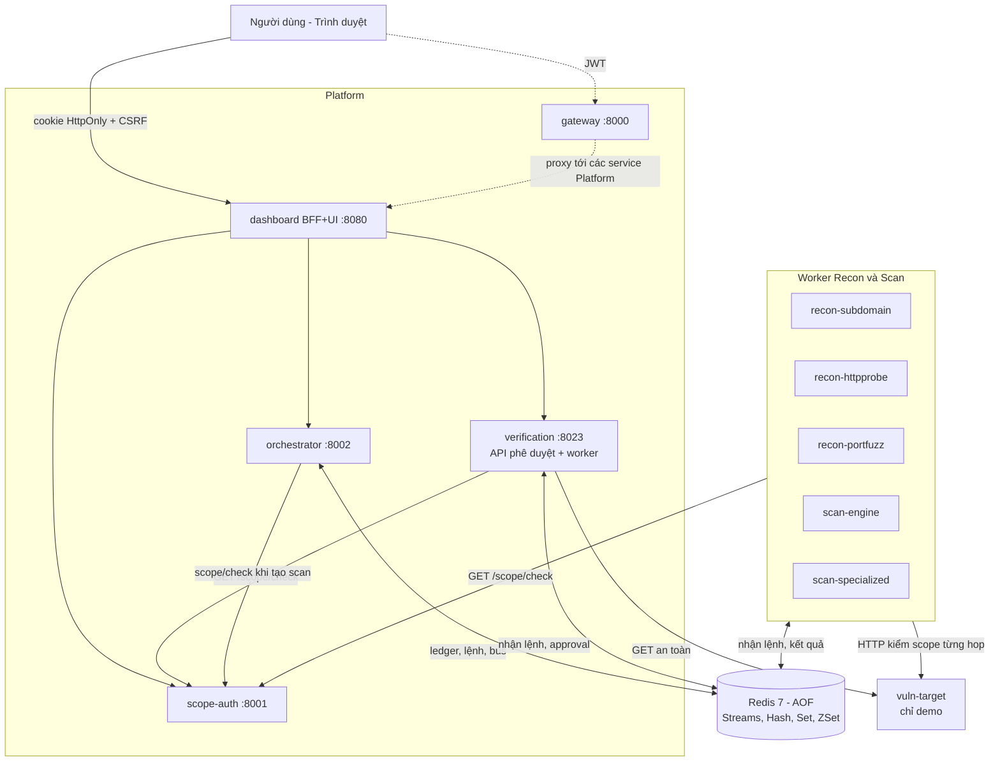

### 2.1 Nguyên tắc thiết kế
1. **Orchestrator là nơi duy nhất ghi trạng thái** scan/stage/work (single writer). Dashboard chỉ hiển thị snapshot có `revision` tăng đơn điệu; không suy ra "xong" từ sự im lặng.
2. **Hướng sự kiện** trên Redis Streams: `vts.bus` (kết quả/lifecycle), `vts.commands.<service>` (lệnh cho worker), `vts.dlq`, `vts.late` (sự kiện lỗi/muộn).
3. **Worker bền vững:** lease + fencing token, heartbeat 5 s, ghi *terminal event + journal* trong một transaction rồi mới `XACK`; work bị bỏ dở được `XAUTOCLAIM` và retry 1/5/15 s (tối đa 3 lần).
4. **Streaming DAG:** Recon, Scan, Verification có thể chạy chồng nhau; stage chỉ đóng khi đã *niêm phong* và hết work mở.
5. **An toàn mặc định:** scope fail-closed, template chỉ method đọc, `DRY_RUN=true`, cổng publish bind `127.0.0.1`.

### 2.2 Danh sách service

| Service | Cổng nội bộ | Vai trò | Lưu trữ |
|---|---|---|---|
| gateway | 8000 | Cửa trước, kiểm JWT, proxy `/{service}/{path}` | không |
| scope-auth | 8000 | Đăng nhập, cấp JWT, CRUD scope, `/scope/check` | Redis `vts:scope:*` |
| orchestrator | 8000 | API scan, ledger, fan-out, retry, watchdog, SSE, lưu lịch sử | Redis `vts:*`; SQLite `/data/history.db` (volume `vts-history-data`) |
| dashboard | 8000 | BFF + UI (sáng/tối): phiên quét, lịch sử, phạm vi, template | không (cookie phiên) |
| recon-subdomain / -httpprobe / -portfuzz | 8000 | Worker Recon | Redis stream |
| scan-engine / scan-specialized | 8000 | Worker Scan | Redis stream, template trong RAM |
| verification | 8000 | Worker Verify + cổng phê duyệt | Redis `vts:approval:*` |
| vuln-target | 80 | Mục tiêu demo cố ý có lỗi (profile `demo`) | không |

---

## 3. Môi trường triển khai

### 3.1 Hệ điều hành và công cụ (đã dùng để kiểm thử)

| Thành phần | Phiên bản |
|---|---|
| Máy chủ phát triển | Windows 10 Pro, build 10.0.19045 |
| Docker Engine / Desktop | 28.4.0 |
| Docker Compose | v2.39.2 |
| Image nền service | `python:3.12-slim` (Debian, Linux) |
| Image Redis | `redis:7-alpine` |
| Python (venv dev/test) | 3.12.10 |
| Python trong image service | 3.12.15 (SQLite 3.46.1 qua module chuẩn `sqlite3`) |

### 3.2 Thư viện (runtime — ràng buộc trong `common/requirements.txt`; phiên bản đã kiểm thử trong `.venv`)

| Thư viện | Ràng buộc | Đã kiểm thử | Dùng cho |
|---|---|---|---|
| fastapi | >=0.110,<1.0 | 0.142.2 | API HTTP, OpenAPI |
| starlette | (phụ thuộc fastapi) | 1.7.0 | ASGI |
| uvicorn[standard] | >=0.29,<1.0 | 0.54.0 | ASGI server |
| pydantic | >=2.6,<3.0 | 2.13.5 | Validate event/snapshot |
| redis (redis-py) | >=5.0,<9.0 | 8.1.0 | Streams, CAS (WATCH/MULTI) |
| httpx | >=0.27,<1.0 | 0.28.1 | HTTP client có hook scope |
| PyJWT | >=2.8,<3.0 | 2.15.1 | JWT HS256 |
| PyYAML | >=6.0,<7.0 | 6.0.3 | Template, cấu hình scan |
| sqlite3 (thư viện chuẩn Python) | đi kèm Python | SQLite 3.46.1 | Lưu lịch sử kiểm tra |

### 3.3 Công cụ kiểm thử (`requirements-dev.txt`)
`pytest==9.1.1`, `playwright==1.63.0` (kiểm thử giao diện bằng Chromium).

### 3.4 Biến môi trường chính
Xem `.env.example`: `JWT_SECRET`, `RECON_EXTERNAL_SOURCES_ENABLED`, các `WORK_*_TIMEOUT_SECONDS`, `WORK_MAX_ATTEMPTS`, `APPROVAL_DEADLINE_SECONDS`, `VTS_BIND_ADDRESS`, các `*_HOST_PORT`.

### 3.5 Nộp bài: mã nguồn + Docker
- Mã nguồn: toàn bộ thư mục `code/`.
- Chạy bằng Docker: `docker compose --profile demo up -d --build` (xem [README.md](../README.md)). Không cần cài thêm gì ngoài Docker.
- Chạy offline (không cần build/Internet): `bash scripts/export_images.sh save vts-images.tar` trên máy đã build, chép file sang máy đích rồi `bash scripts/export_images.sh load vts-images.tar` và `docker compose --profile demo up -d --no-build`. Đã chạy thử `save` rồi `load` thành công trên Docker Desktop (11 image VTS + `redis:7-alpine`).
- Dựng máy ảo Ubuntu: `sudo bash scripts/setup_vm.sh --start` (cài Docker Engine + Compose từ kho chính thức rồi khởi động VTS). Script đã qua kiểm tra cú pháp (`bash -n`) nhưng **chưa chạy trên máy ảo thật**.
- Nếu thầy yêu cầu **máy ảo**: dùng bất kỳ VM Linux (Ubuntu 22.04/24.04) cài Docker Engine ≥ 24 và Compose v2; chép thư mục `code/` rồi chạy đúng lệnh trên. (Phần VM chưa được kiểm thử trong phạm vi báo cáo này; môi trường đã kiểm thử là Windows 10 + Docker Desktop.)

---

## 4. Use case

### 4.1 Use case tổng quan

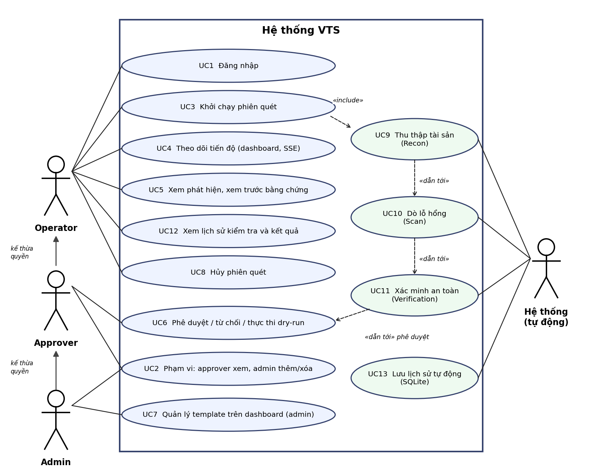

### 4.2 Phân rã use case

**UC2 — Phạm vi được phép** (approver chỉ xem, admin xem và sửa; operator không thấy mục này)
- UC2.1 Xem danh sách scope (approver, admin)
- UC2.2 Thêm mục tiêu (domain / wildcard `*.x` / CIDR), bắt buộc tích xác nhận "được phép kiểm thử"
- UC2.3 Xóa mục tiêu (chỉ admin, có hộp xác nhận)
- UC2.4 Kiểm tra mục tiêu (`GET /scope/check`, dùng nội bộ bởi mọi service)

**UC3 — Khởi chạy phiên quét**
- UC3.1 Chọn chế độ `full` / `recon` / `recon-passive`
- UC3.2 Chọn thực thi `sequential` / `parallel`
- UC3.3 Kiểm tra scope trước khi tạo (từ chối 403 nếu ngoài scope)
- UC3.4 Idempotency-Key: gửi lại cùng key trả lại cùng scan

**UC6 — Phê duyệt và thực thi**
- UC6.1 Phê duyệt (approve) — *chưa* thực thi
- UC6.2 Từ chối (reject) — hủy work execute đang chờ
- UC6.3 Thực thi (execute, mặc định dry-run) — chỉ sau approve
- UC6.4 Quá hạn quyết định ⇒ scan `timed_out`

**UC7 — Quản lý template trên dashboard** (chỉ `admin`)
- UC7.1 Thêm template (soạn YAML, nút Chèn mẫu)
- UC7.2 Kiểm tra trước khi lưu (chặn key `command/exec/shell...`, method ngoài GET/HEAD/OPTIONS, regex ReDoS)
- UC7.3 Xem danh sách và xóa (có hộp xác nhận)

**UC9 — Recon (hệ thống)**: subdomain+OSINT → HTTP probe+harvest → port scan → content fuzz.
**UC10 — Scan (hệ thống)**: template engine (5 template mẫu + template do admin thêm) + specialized (XSS/CRLF/S3).

**UC12 — Lịch sử kiểm tra** (mọi vai trò)
- UC12.1 Lọc theo mục tiêu và kết quả, phân trang
- UC12.2 Xem chi tiết: giai đoạn, phát hiện theo mức độ, phê duyệt, người chạy
- UC12.3 Xuất CSV phát hiện / tải JSON

**UC13 — Lưu lịch sử tự động (hệ thống)**: tiến trình nền của orchestrator lưu mọi scan đã kết thúc (thành công, thất bại, hết hạn, bị hủy) vào SQLite, mỗi 5 giây, không trùng lặp.

---

## 5. Phân tích thiết kế — luồng chính: "Khởi chạy scan → phát hiện → xác minh → phê duyệt"

### 5.1 Sơ đồ tuần tự

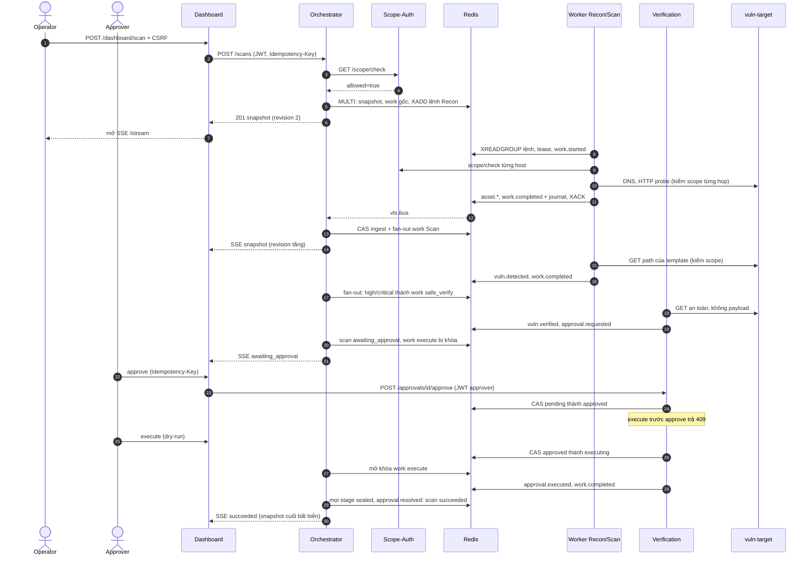

### 5.2 Sơ đồ hoạt động

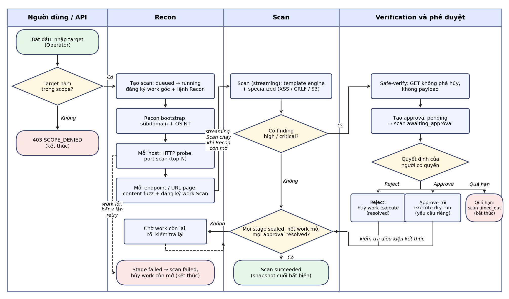

### 5.3 Cơ sở dữ liệu (Redis — keyspace `vts:`)

Hệ thống không dùng CSDL quan hệ; toàn bộ trạng thái bền vững nằm trong Redis (AOF `appendfsync everysec`, volume `vts-redis-data`).

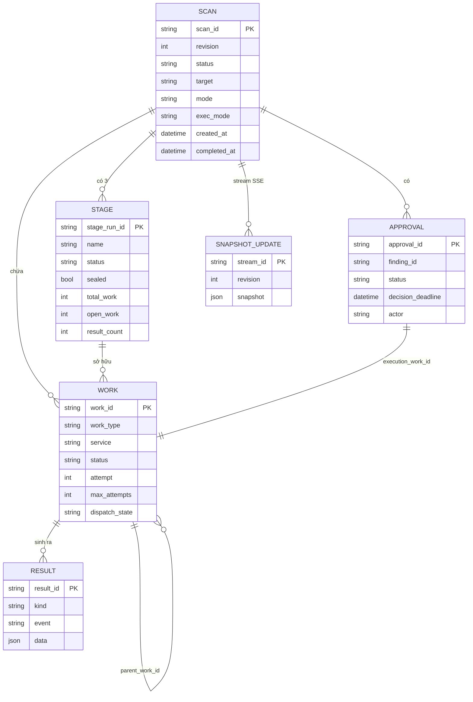

| Khóa Redis | Kiểu | Nội dung |
|---|---|---|
| `vts:scan:index` | ZSET | scan_id theo thời gian tạo (`scan_history`) |
| `vts:scan:{id}:snapshot` | STRING (JSON) | snapshot authoritative, có `revision` |
| `vts:scan:{id}:works` | SET | work_id thuộc scan |
| `vts:work:{id}` / `vts:stage:{stage_run_id}` | HASH | bản ghi work / stage |
| `vts:scan:{id}:results:{assets, findings, verified, execution}` | ZSET | chỉ mục kết quả; nội dung ở `vts:result:{result_id}` (STRING) |
| `vts:scan:{id}:event_ids`, `…:result_ids` | HASH | khử trùng lặp |
| `vts:scan:{id}:updates` | STREAM (≤1000) | snapshot đầy đủ cho SSE / `Last-Event-ID` |
| `vts:retry` | ZSET | work chờ retry (score = thời điểm) |
| `vts:idempotency:scan:{key}` | HASH | hash yêu cầu + snapshot (TTL 8 ngày) |
| `vts:approval:{id}`, `vts:approval:index`, `vts:scan:{id}:approvals` | HASH/SET | phê duyệt |
| `vts:idempotency:approval:{key}` | HASH | phát lại hành động phê duyệt |
| `vts:lease:work:{id}` | STRING (TTL 15 s) | lease/fencing token |
| `vts:worker:{svc}:{work}:{attempt}` | HASH | journal thực thi (terminal_event_id…) |
| `vts:scope:items`, `vts:scope:next_id` | HASH/STRING | luật scope |
| `vts.bus`, `vts.commands.{svc}`, `vts.dlq`, `vts.late`, `vts:late` | STREAM | bus sự kiện, lệnh, thư chết, sự kiện muộn |

TTL: dữ liệu scan đã kết thúc giữ 604 800 s (7 ngày); marker khử trùng lặp 691 200 s (8 ngày).

#### Lịch sử kiểm tra lâu dài (SQLite)

Redis chỉ giữ dữ liệu scan 7 ngày, nên mỗi scan đã kết thúc được lưu thêm vào một CSDL quan hệ SQLite (tệp `/data/history.db`, volume Docker `vts-history-data`, chế độ WAL, khóa ngoại bật). Bản ghi gồm: mục tiêu, chế độ, kết quả, người chạy, thời điểm, thời lượng, số tài sản/phát hiện/đã xác minh, số phát hiện theo mức độ, tình trạng phê duyệt và các giai đoạn; mỗi phát hiện là một dòng ở bảng con. Bằng chứng và nội dung phản hồi **không** được lưu.

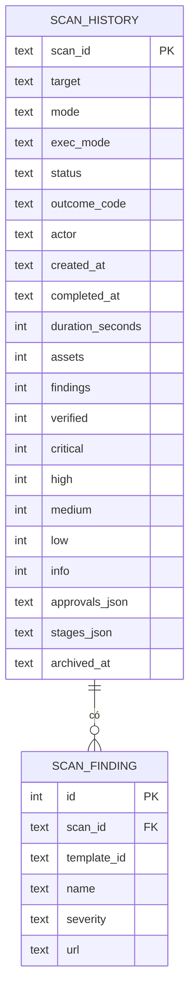

Truy vấn: `GET /history?status=&target=&limit=&offset=` (lọc theo kết quả, tìm theo tên mục tiêu, sắp xếp mới nhất trước) và `GET /history/{scan_id}` (kèm danh sách phát hiện). Lưu lại cùng một scan nhiều lần là thay thế chứ không nhân đôi. Các scan còn trong Redis lúc nâng cấp được nạp bù khi orchestrator khởi động; những bản nạp bù này không có thông tin người chạy.

---

## 6. Trạng thái và quy tắc

- **Scan:** `queued → running → awaiting_approval ⇄ running → succeeded | failed | timed_out | canceled`.
- **Stage:** `pending → running → succeeded | failed | timed_out | skipped`.
- **Work:** `queued → running → completed | failed | timed_out | canceled` (retry đưa về `queued`, attempt+1).
- Bất biến: trạng thái kết thúc không đổi; sự kiện trùng/muộn/attempt cũ chỉ vào audit.
- `work.completed` với `result_count=0` là **thành công hợp lệ** (không phải bỏ qua).

---

## 7. Bảo mật và kiểm soát phạm vi

### 7.1 Ma trận quyền theo vai trò

Vai trò lồng nhau: `admin` ⊃ `approver` ⊃ `operator`. Quyền được kiểm ở dashboard (BFF) và kiểm lại ở service phía sau.

| Chức năng | operator | approver | admin |
|---|:-:|:-:|:-:|
| Đăng nhập, khởi chạy scan, theo dõi tiến độ, xem phát hiện, hủy scan | Có | Có | Có |
| Xem lịch sử kiểm tra và chi tiết | Có | Có | Có |
| Phê duyệt / từ chối / thực thi dry-run | Không (403) | Có | Có |
| Xem danh sách phạm vi được phép | Không (403, ẩn khỏi menu) | Có (chỉ xem) | Có |
| Thêm / xóa mục tiêu trong phạm vi | Không (403) | Không (403) | Có |
| Quản lý template trên dashboard (xem, kiểm tra, thêm, xóa) | Không (403) | Không (403) | Có |

### 7.2 Rủi ro và biện pháp

| Rủi ro | Biện pháp |
|---|---|
| Quét ngoài scope | `scope/check` trước khi hành động; `scoped_http_client` kiểm từng hop redirect; link ngoài scope bị lọc; scope-service lỗi ⇒ từ chối |
| Tự động khai thác | Không có mã khai thác; `execute` chỉ chạy dry-run; yêu cầu `approved` + role `approver/admin`; CAS ngăn hai hành động đồng thời |
| Template độc hại | Validate: chặn key nguy hiểm, method ghi, regex ReDoS, giới hạn 512 KB phần thân khi khớp |
| Giả mạo quyền | Role lấy từ JWT do scope-auth ký, không do client khai; cookie HttpOnly + SameSite=Strict + header CSRF |
| Lộ cổng nội bộ | Cổng publish chỉ bind `127.0.0.1` |
| Lặp thao tác | `Idempotency-Key` cho tạo scan và phê duyệt |

**Biện pháp bổ sung trong đợt hoàn thiện:** port scan chỉ chạy với IP phân giải thuộc dải riêng/loopback/link-local **hoặc** IP đã nằm trong scope (IP công cộng của một tên miền trong scope sẽ bị bỏ qua với `skipped=ip_not_in_scope`); template người dùng lưu bền trong Redis (`vts:templates:user`), chỉ `admin` tạo/xóa, scan-engine đồng bộ lại sau mỗi 5 s và sau khi khởi động lại.

**Hạn chế đã biết (chỉ dùng trong lab):** người chạy scan có thể tự phê duyệt chính scan đó (chưa tách nhiệm vụ) và mọi người dùng thấy mọi scan; Redis chưa có ACL/TLS và sự kiện chưa được ký; `JWT_SECRET` và 3 tài khoản demo (`operator/approver/admin`) là giá trị mặc định; một số API thủ công cũ (`/discover`, `/probe`, `/portscan`, `/fuzz`, `/scan`) vẫn còn cho demo; thông báo email chưa được hiện thực (webhook tùy chọn có, mặc định tắt; scan bị hết hạn bởi watchdog kỹ thuật chưa kích hoạt webhook); scan-engine đồng bộ template theo chu kỳ 5 s nên template mới có hiệu lực chậm tối đa khoảng 5 s.

---

## 8. Kịch bản vận hành / kiểm thử / đo đạc

### Kịch bản A — End-to-end trên mục tiêu nội bộ (kịch bản chính)
**Mục tiêu:** chứng minh Definition of Done: domain → tài sản → lỗ hổng bằng template tự viết → xác minh an toàn → phê duyệt → dashboard.

**Chuẩn bị** (stack cô lập, nguồn ngoài tắt):
```powershell
$env:REDIS_HOST_PORT="16379"; $env:GATEWAY_HOST_PORT="18000"; $env:SCOPE_HOST_PORT="18001"
$env:ORCHESTRATOR_HOST_PORT="18002"; $env:DASHBOARD_HOST_PORT="18080"
$env:RECON_SUBDOMAIN_HOST_PORT="18011"; $env:RECON_HTTPPROBE_HOST_PORT="18012"; $env:RECON_PORTFUZZ_HOST_PORT="18013"
$env:SCAN_ENGINE_HOST_PORT="18021"; $env:SCAN_SPECIALIZED_HOST_PORT="18022"; $env:VERIFICATION_HOST_PORT="18023"; $env:VULN_TARGET_HOST_PORT="18090"
$env:RECON_EXTERNAL_SOURCES_ENABLED="false"
docker compose -p vts-lifecycle-test -f docker-compose.yml -f docker-compose.test.yml --profile demo up -d --build
```
**Thực hiện:** `python scripts/e2e_test.py` (đăng nhập `approver`, đưa scope về đúng `vuln-target`, tạo scan `full/parallel`, tự động reject một approval và approve+execute approval còn lại).

**Kết quả thực tế (chạy ngày 2026-10-08; hai lần chạy liên tiếp cho cùng kết quả: PASS, revision 58, 12 work, 2 approval):**

| Mốc revision | Trạng thái |
|---|---|
| 2 | scan `running`, Recon `running` (3 và 8: Recon tiếp tục nhận kết quả) |
| 25 | Recon **và** Scan cùng `running` (streaming DAG) |
| 37 | cả 3 stage `running` |
| 52 | scan `awaiting_approval`; Recon, Scan `succeeded` |
| 58 | scan `succeeded` (sau 1 reject + 1 approve→execute) |

- 12 work ID duy nhất; 2 approval (1 `rejected`, 1 `executed`).
- Kết quả: **10 tài sản, 5 phát hiện, 2 đã xác minh**. Số kết quả theo stage khớp tổng (sau khi sửa lỗi đếm đôi, xem §10).
- Phát hiện: `env-file-exposure` (high), `specialized-xss-reflected` (high), `git-config-exposure`, `phpinfo-disclosure`, `spring-actuator-exposure` (medium).
- Kiểm tra phụ trong E2E: `execute` trước `approve` bị 409; lệnh gửi cho worker chỉ chứa host `vuln-target`; Redis AOF bật.

### Kịch bản B — Kiểm thử tự động
```powershell
$env:VTS_TEST_REDIS_URL="redis://127.0.0.1:16379/15"
.\.venv\Scripts\python.exe -m pytest .\common\tests .\services\scan-engine\tests .\services\orchestrator\tests .\services\dashboard\tests .\services\verification\tests .\tests\test_lifecycle_docs.py .\tests\integration -q -p no:cacheprovider
.\.venv\Scripts\python.exe -m pytest .\tests\browser -q -p no:cacheprovider   # cần: playwright install chromium
```
**Kết quả:** **191 passed** (≈59 s) ở bản cuối (các mốc trước: 162, rồi 179). Phần tăng thêm gồm test hồi quy đếm kết quả (red-green đã kiểm chứng: bỏ bản sửa thì fail `2 == 1`), `/readyz` của gateway, báo cáo tổng hợp, webhook, quản lý template và kiểm tra IP khi quét port. Bao gồm: unit test từng loại matcher/extractor và validate template (`services/scan-engine/tests`), FSM, ledger Redis, CAS phê duyệt một người thắng, thu hồi worker, migration, scope. Test giao diện Playwright (`tests/browser`): **13 passed** (≈27 s; 4 test gốc cộng 9 test cho chế độ sáng/tối, ẩn mục theo vai trò, bảng lịch sử, chống XSS, xuất CSV, liên kết bỏ qua, không tràn ngang ở 375 px): ba stage cùng `running`, nhãn trạng thái, snapshot cũ không ghi đè snapshot mới, polling nối tiếp.

### Kịch bản C — Đo đạc hiệu năng (`python scripts/measure.py`)

| Chỉ số | Lần đo 1 | Lần đo 2 | Lần đo 3 (bản hoàn thiện) | Ngưỡng của script |
|---|---|---|---|---|
| Độ trễ detail dự phòng (polling) p95 | 0,0405 s | 0,0432 s | 0,0396 s | ≤ 2 s |
| Giao SSE ban đầu p95 | 0,0410 s | 0,0603 s | 0,0822 s | ≤ 1 s |
| Chờ trong hàng đợi (queue wait) p95 | 0,3101 s | 0,2263 s | 0,2621 s | — |
| Thời gian chạy work p95 | 0,6068 s | 0,6872 s | 0,6798 s | — |

Sau khi thêm lịch sử và giao diện mới, ba lần đo liên tiếp cho: polling p95 0,063–0,090 s; SSE p95 0,047–0,086 s; chờ hàng đợi p95 0,15–0,73 s; thời gian chạy work p95 1,02–2,71 s. Mức dao động lớn hơn các lần đo đầu (0,61–0,69 s) do Docker Desktop dùng chung máy với stack khác đang chạy; mọi lần đo vẫn nằm trong ngưỡng của script.

Môi trường đo: 1 máy Windows 10 + Docker Desktop, mọi service chạy cục bộ, mục tiêu cục bộ — số liệu phản ánh overhead của hệ thống, không phải hiệu năng quét Internet.

### Kịch bản D — Chống vi phạm scope (kiểm thử âm)
1. Đăng nhập `admin`, xóa `vuln-target` khỏi scope → `POST /scans {"target":"vuln-target"}` trả **403 SCOPE_DENIED** (đã chạy: đúng; sau đó thêm lại scope, tạo scan trả 201).
2. Đăng nhập `operator`, `POST /scope` → **403** (đã chạy: đúng; chỉ admin được sửa scope).
3. Redirect ra ngoài scope bị chặn trước request thứ hai (test `common/tests/test_scope.py`).

### Kịch bản E — Phục hồi sau khởi động lại
`python scripts/e2e_test.py --capture-restart-state <file>` → `docker compose … restart dashboard orchestrator redis` → `--verify-restart-state <file>`. **Kết quả đã chạy:** scan `dde6b27d…` (chế độ `recon-passive`) giữ nguyên revision 12 và trạng thái sau khi khởi động lại cả ba thành phần, phục hồi trong ≤ 5 s (`[restart] recovered revision=12 within 5s`). Runbook chi tiết trong `BaoCao.md` §8.4.

### Kịch bản F — Báo cáo tổng hợp và quản lý template (chức năng bổ sung)
Đã chạy trên stack cô lập sau bản hoàn thiện:

| Bước | Kết quả quan sát |
|---|---|
| `GET /scans/{id}/report` cho scan E2E | `status=succeeded`, `summary` 10 tài sản / 5 phát hiện / 2 đã xác minh; `findings_by_severity` high 2, medium 3; mỗi stage có `result_count` khớp (10/5/2); nội dung không chứa evidence |
| `GET /dashboard/scans/{id}/report` (cookie phiên) | 200 (401 nếu chưa đăng nhập) |
| `operator` tạo template | **403** |
| `admin` tạo template `user-demo` | **201**; scan-engine nạp trong ≤ 7 s |
| Khởi động lại `scan-specialized` và `scan-engine` | template vẫn còn ở cả hai nơi (lưu Redis) |
| `operator` xóa template / `admin` xóa template | **403** / **200**; scan-engine bỏ template trong ≤ 7 s |
| Webhook | bật bằng `WEBHOOK_URL` + `WEBHOOK_ALLOWED_HOSTS`; kiểm thử bằng test tự động (tắt mặc định; chỉ gửi tóm tắt; host ngoài danh sách bị từ chối). Chưa thử gửi tới máy chủ nhận thật |

---

### Kịch bản G — Phân quyền, quản lý template trên dashboard và lịch sử kiểm tra
Chạy trên stack cô lập sau bản cuối (dịch vụ thật, không giả lập):

| Bước | Kết quả quan sát |
|---|---|
| `GET /scope` trên scope-auth theo vai trò | operator **403**, approver **200**, admin **200** |
| `POST /scope` bằng operator / approver | **403** / **403** |
| Dashboard: `scope`, `templates`, `history` | operator 403, 403, 200; approver 200, 403, 200; admin 200, 200, 200 |
| Chạy E2E rồi gọi `GET /history` | scan mới xuất hiện với `actor=approver`, 10 tài sản, 5 phát hiện (high 2, medium 3), 2 đã xác minh; tổng 14 bản ghi (gồm các scan cũ nạp bù) |
| Mở tệp SQLite trong container | 14 dòng `scan_history`, 60 dòng `scan_finding` (high 24, medium 36) |
| Tạo lại container orchestrator | lịch sử vẫn còn 14 bản ghi (dữ liệu nằm ở volume) |
| Giao diện (Playwright chụp từ stack thật) | các màn Phiên quét, Lịch sử, Chi tiết, Phạm vi (admin và approver), Template ở cả chế độ sáng và tối; operator chỉ thấy 2 mục menu; xem Phụ lục |

---

## 9. Hướng dẫn chạy và demo thủ công
Xem [README.md](../README.md): khởi động, đăng nhập dashboard (`operator/operator123`, `approver/approver123`, `admin/admin123` — chỉ lab), quét `vuln-target`, phê duyệt, tắt stack (không dùng `-v`).

## 10. Thay đổi mã trong đợt hoàn thiện này
Mỗi thay đổi hành vi đều có test viết trước (đã quan sát test fail rồi mới sửa).
- **Sửa lỗi** `services/orchestrator/app/ledger.py`: `result_count` của stage bị cộng hai lần (khi nhận kết quả và khi work hoàn tất) nên dashboard hiển thị gấp đôi số kết quả theo stage. Kiểm chứng runtime: stage recon/scan/verification = 10/5/2 khớp `result_summary`.
- **Gateway:** thêm `GET /readyz` (sẵn sàng khi scope-auth sẵn sàng; 503 nếu không).
- **Báo cáo tổng hợp:** `GET /scans/{id}/report` (orchestrator) + proxy ở dashboard; không đưa evidence vào báo cáo.
- **Webhook tùy chọn:** `services/orchestrator/app/notify.py`; tắt mặc định; chỉ gửi tóm tắt khi scan kết thúc; host phải nằm trong `WEBHOOK_ALLOWED_HOSTS`; lệnh hủy lặp lại cùng Idempotency-Key không gửi lần hai.
- **Port scan:** chỉ quét IP riêng/loopback/link-local hoặc IP nằm trong scope.
- **Template người dùng:** lưu bền trong Redis, chỉ admin tạo/xóa; scan-engine đồng bộ định kỳ.
- **Sửa mã hóa tiếng Việt** trong mô tả OpenAPI của 5 service.
- **Đóng gói:** `scripts/setup_vm.sh`, `scripts/export_images.sh`; biến webhook trong `docker-compose.yml` và `.env.example`.
- **Phân quyền phạm vi:** `GET /scope` chỉ cho admin và approver (operator nhận 403); chỉ admin thêm/xóa; dashboard kiểm lại quyền ở BFF.
- **Template trên dashboard (admin):** các route `/dashboard/templates` (xem, kiểm tra, thêm, xóa) và mục Template trong giao diện.
- **Lịch sử kiểm tra:** `history.py` (SQLite, tiến trình nền lưu mọi scan đã kết thúc), API `/history`, proxy dashboard, mục Lịch sử có lọc, phân trang, chi tiết, xuất CSV/JSON; orchestrator ghi thêm người chạy scan (`vts:scan:{id}:meta`).
- **Giao diện mới:** viết lại `index.html` với chế độ sáng/tối (theo hệ thống, nhớ lựa chọn), điều hướng theo vai trò, responsive, rà soát theo Web Interface Guidelines (liên kết bỏ qua, `theme-color`, nhãn và `name` cho ô nhập, khóa nút khi đang gửi, hộp xác nhận trước khi xóa).
- **Kiểm thử:** thêm 13 test phía dịch vụ và 9 test giao diện; `scripts/test_stack_env.sh` nạp biến cho stack test.
- **Tài liệu:** báo cáo này, `BaoCao_VTS.docx` (sinh bằng `build/make_docx.py`, sơ đồ trong `build/diagrams/`), `README.md` gốc và từng service, `docs/PROMPT_HOAN_THIEN.md`.

---

## Phụ lục. Giao diện hệ thống

Ảnh chụp từ stack thật bằng Playwright (`build/ui_shots.py`). Chế độ sáng và tối dùng cùng bố cục.

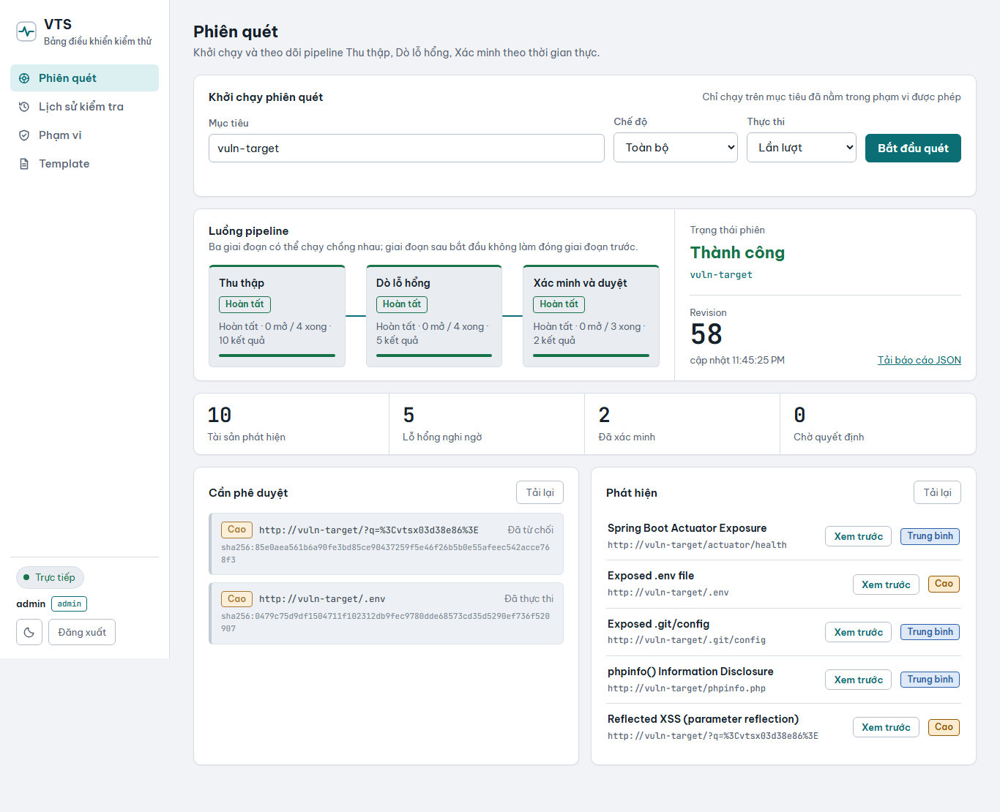

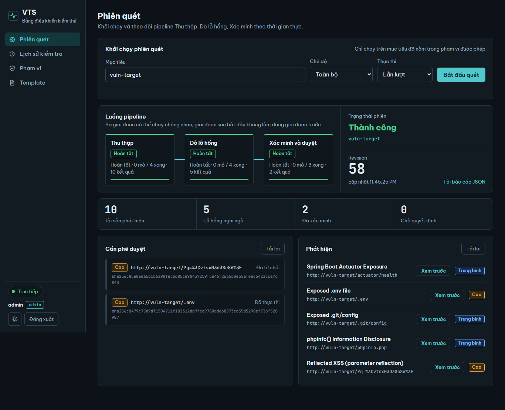

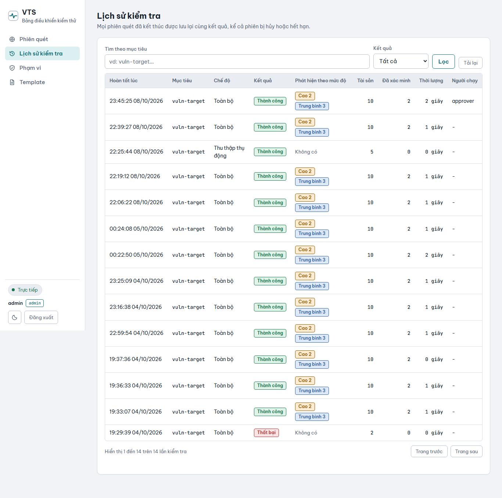

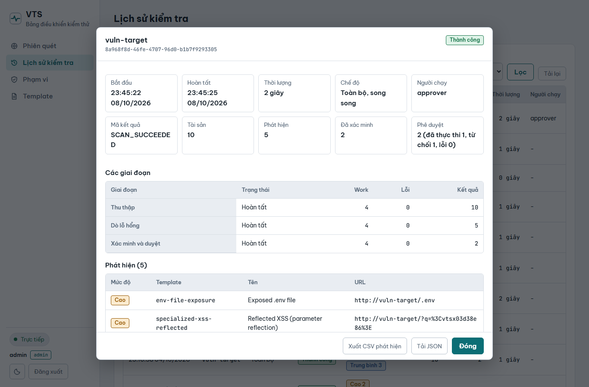

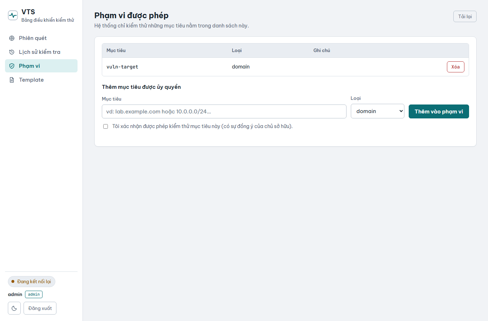

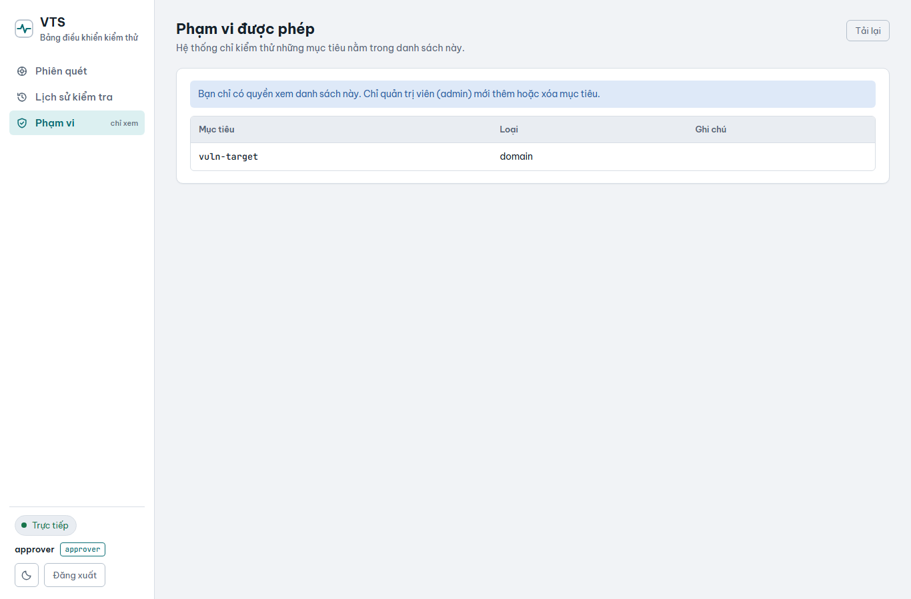

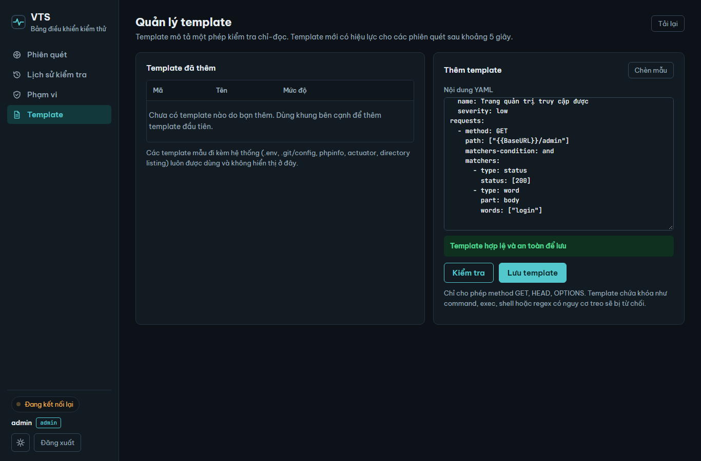

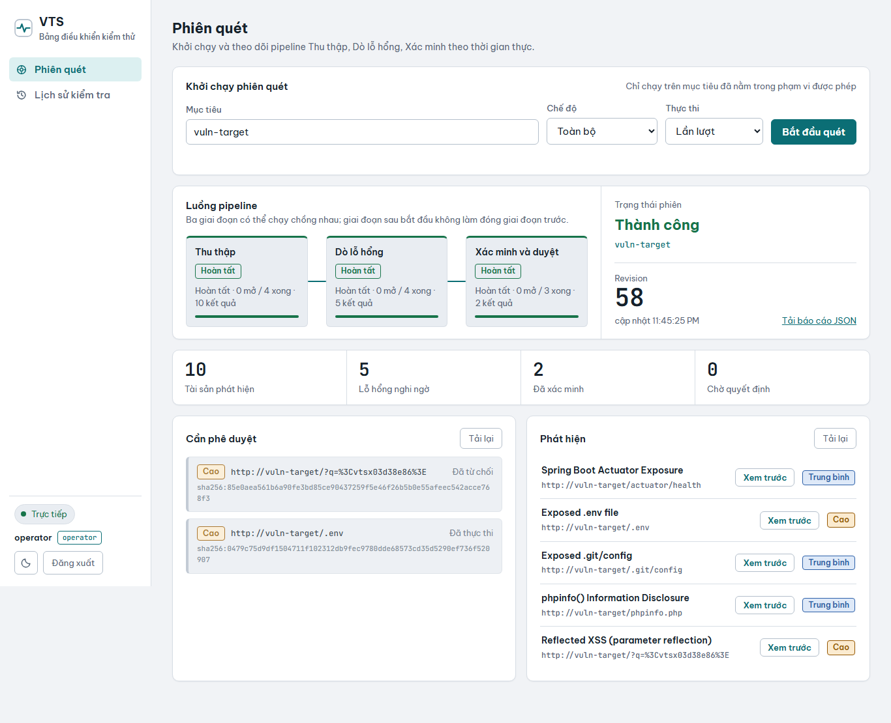

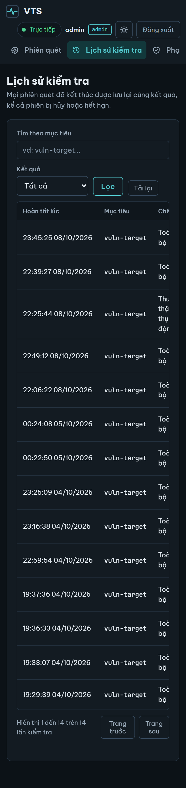
